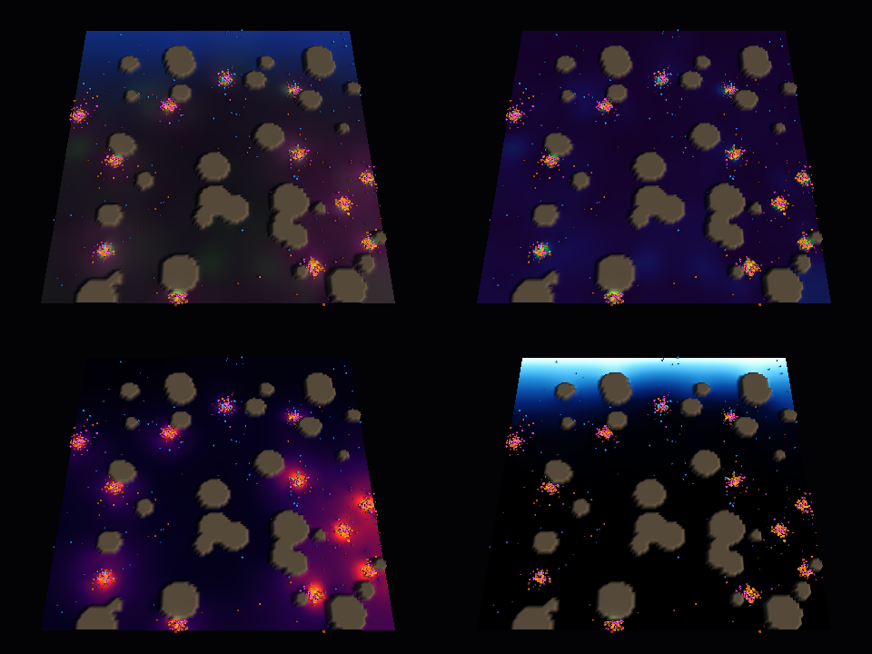
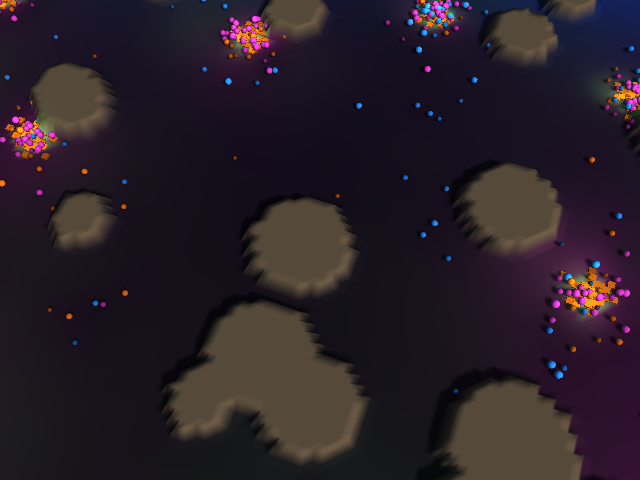
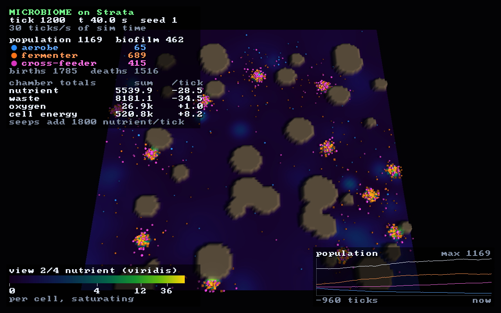
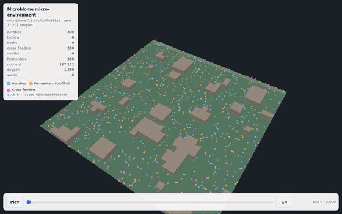
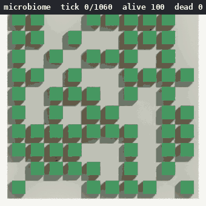

# microbiome

[](https://danielstephenson.dev/play/microbiome)

This application allows the user to witness the activity of a virtual microbial community.

<p align="center">
  
  <br>
  <em>The opt-in Strata build (<code>mb_strata</code>): 960 ticks of a 128×128 chamber, simulated with Strata's
  <code>strata::sim</code> and drawn by the Strata engine (headless, Mesa llvmpipe), with the live statistics
  overlay. Green is nutrient, purple waste, blue oxygen; see <a href="#micro-environment-on-strata-opt-in">below</a>.</em>
</p>

## Play in your browser
The Strata micro-environment (below) runs entirely in your browser, compiled to WebAssembly and drawn with
WebGL 2, no server needed. Drag to pan and scroll (or pinch) to zoom; the buttons switch the field, the
clock and the statistics overlay:

- https://microbiome.play.danielstephenson.dev
- or find it among the other games at https://danielstephenson.dev/play

The original 2D grid stays available at https://microbiome.play.danielstephenson.dev/classic/ (it also
works in browsers without WebGL 2).

This is in addition to the existing server-backed live viewer at https://microbiome.preponderous.org, which stays as it is.

To build the Strata page yourself, see [docs/STRATA.md](docs/STRATA.md#in-a-browser) (`emcmake cmake -S strata -B build-web`).
To build the classic page, activate an [Emscripten SDK](https://emscripten.org/docs/getting_started/downloads.html) (CI uses 6.0.11) and run `make web` (or `web/build.sh`). It writes `web/build/index.html`, `index.js` and `index.wasm`; serve that directory with any static file server, e.g. `python3 -m http.server -d web/build 8000`, and open http://localhost:8000. The entry point is `src/browser.cpp` (the page is `web/shell.html`): it runs the same `Microbiome` the console app and web server run, one tick every 200 ms, starting a new generation after an extinction just like `mb_webapp`. It reports no usage, writes no log files, and the native targets never compile it. `.github/workflows/browser.yml` builds both pages on every pull request and push, smoke-tests the Strata page in headless Chromium and deploys the site (Strata at `/`, classic at `/classic/`).

## Micro-environment on Strata (opt-in)
`mb_strata` simulates a much richer micro-environment with the
[Strata](https://github.com/Preponderous-Software/strata) engine: a 128×128 chamber (any size up to
1025×1025) with **diffusing nutrient, waste and oxygen fields**, solid **grains** that biofilms grow on,
and three species of microorganism as Strata entities:

- **aerobes** (blue) swim up the nutrient gradient and need oxygen, which only diffuses in from the air
  interface at the top edge, for a full yield;
- **fermenters** (orange) are anaerobes that oxygen harms; they settle into **biofilms** (flat tiles) on
  grains, on the chamber wall or when crowded, and disperse again when starving;
- **cross-feeders** (pink) live on the others' waste and swim up the waste gradient.

The console app's traits carry over: starting energy and metabolic rate ranges, binary fission at 900
energy with a cost of 100, biomass returned to the environment on death and an 80% chemotaxis bias,
now applied to a run-and-tumble walk up real gradients. Nutrient seeps below the oxic band set up
opposing gradients, as in a Winogradsky column.

<p align="center">
  
  <br><em>One chamber at tick 600 in the four field views: composite, nutrient, waste and oxygen.</em>
</p>
<p align="center">
  
  <br><em>Zoomed in (<code>--zoom 2.2 --yaw 20</code>): colonies at nutrient seeps beside grains, lit by Strata's sun and point lights.</em>
</p>

<p align="center">
  
  <br><em>The statistics overlay at 1280×800 (nutrient view, tick 1200). Tab hides it in the window; <code>--no-hud</code> turns it off.</em>
</p>

The overlay is drawn with Strata's unlit overlays (ABI 1.5): the text is Strata's 8×8 bitmap font, the
panels, colour bar and sparkline are overlay lines, and the species markers are overlay points. It shows
the tick and simulated time, the speed or pause state, each species' population and the biofilm count,
births and deaths, the chamber's nutrient, waste, oxygen and cell-energy totals with their change per
tick (next to the 1,800 units of nutrient the seeps add each tick), a legend for the current field view
and the population of each species over the last 960 ticks. It only reads the simulation, so a run's
state hash is the same with it on or off.

It is deterministic: the simulation draws every random number from one seeded generator, runs on a fixed
tick and never reads a clock, so a seed gives a bit-identical state hash after the same number of ticks.
Measured with `mb_strata --bench` (simulation only, one thread, GCC 9.4 Release build on an i9-10850K):
the default 128×128 chamber, with a mean population of about 1,100, runs at about 1,150–1,250 ticks per
second; a 256×256 chamber (`--size 256 --per-species 1200`, mean population about 2,000) at about 290.

Building it needs CMake 3.24 or newer, a C++17 compiler and SDL3's X11 headers (`libx11-dev libxext-dev
libxrandr-dev libxcursor-dev libxi-dev libxfixes-dev libxss-dev` on Debian/Ubuntu); CMake fetches Strata at
the commit pinned in `strata/strata.ref`:

```sh
make strata                                   # or: cmake -S strata -B build-strata && cmake --build build-strata -j4
ctest --test-dir build-strata --output-on-failure
build-strata/mb_strata                        # a window; H prints the controls
build-strata/mb_strata --headless --ticks 600 --screenshot out.png    # no window, no X server
build-strata/mb_strata --headless --ticks 960 --frames frames/ --frame-every 12
build-strata/mb_strata --bench --ticks 2000   # ticks per second, no rendering
```

In the window: WASD/arrows pan, Q/E rotate, mouse wheel or +/- zoom, drag to pan, 1–4 switch the field
view, space pauses, `,`/`.` change speed, Tab shows or hides the statistics overlay, R starts a new seed.
Options: `--seed`, `--size`, `--per-species`, `--view`, `--zoom`, `--yaw`, `--tps`, `--no-hud`,
`--hud-scale N` (glyph size in multiples of 8 pixels; by default it follows the window height),
`--record run.usda` (below).

### Shareable replays (`--record`)
`mb_strata --record run.usda` writes the run as a replay in the
[`usd-replay/1`](https://github.com/Preponderous-Software/usd-recorder/blob/v0.2.0/docs/REPLAY.md) contract:
one OpenUSD layer that any player can show without knowing the simulation. Each species is one `Points`
set with stable ids, the chamber's heatmap (in the `--view` colours) is a coarse colour grid, the grains
are static cubes, and every sample carries the run's state hash, so anyone can re-run the seed and check it.

```sh
build-strata/mb_strata --headless --ticks 2000 --no-hud --record run.usda --record-every 10 --record-field 32
pip install "usd-recorder @ git+https://github.com/Preponderous-Software/usd-recorder@v0.2.0"
usd-recorder replay validate run.usda && usd-recorder replay convert run.usda run.usdc
```

<p align="center">
  
  <br><em>Seed 1, 2,000 ticks, a sample every 10: a 19.3 MB <code>.usda</code> (5.7 MB as <code>.usdc</code>),
  converted with <a href="https://github.com/Preponderous-Software/usd-web">usd-web</a> to a 1.3 MB web replay
  and played in its browser player.</em>
</p>

Recording only reads the simulation: the state hash is the same with and without `--record`, which a test
checks tick by tick and CI checks again on a full run. Samples are taken every `--record-every N` ticks
(default 10) plus the first and last tick; `--record-field N` sets the heatmap's columns (default 32). In
the window the file is written on quit (R, a new chamber, ends the recording). The writer is
usd-recorder's dependency-free C++ header, vendored at v0.2.0 (MIT) in `strata/vendor/usd_recorder/`, so
no OpenUSD is needed. CI uploads each pull request's replay, validated and converted to `.usdc`, as the
`mb-strata-replay` artifact.

This build is separate from everything else: `make`, `mb_app`, `mb_webapp` (microbiome.preponderous.org),
the classic browser build and both test suites are unchanged and do not need CMake or Strata. Built with
Emscripten, `mb_strata` is the arcade page, on Strata's WebGL 2 (OpenGL ES 3.0) backend.
`.github/workflows/strata.yml` builds and tests it in CI. The design, what moved to Strata and what
stayed, and the known gaps are in [docs/STRATA.md](docs/STRATA.md). `mb_strata` reports no usage and
writes no log files.

## Example Console Output
```
==============================
    .        o     o  o       
          .        +     .    
 +  o           +  +        . 
       o        +  +  o  o    
    +           o  .  +  o  . 
    o  !  +  !  o             
 +  +        +              o 
          +     +  .  +  +    
 o  +        .  !     !       
       !  o  .     .        o 
==============================

Name: Simulation 1
Size: 10x10
Microorganisms: 45
Dead Microorganisms: 55
Total Energy: 1858

Ticks elapsed: 16
```

Each cell of the grid shows what is at that location:

- `o` - a living microorganism
- `+` - a living microorganism that has foraged biomatter at least once
- `!` - a living microorganism with less than 10 energy left (shown in place of `o` or `+`)
- `.` - biomatter with no microorganism on it
- blank - an empty location

By default (`AppConfig`), `mb_app` runs 10 simulations one after another, each on a 10x10 grid
starting with 100 microorganisms, as fast as possible and until every microorganism has died. The
screen is redrawn every tick. Once all of them have finished it prints the average ticks elapsed,
dead and surviving microorganisms and total energy across the simulations.

## Testing
The project uses **Catch2** for all of its tests, split into two suites: `./mb_tests` (the simulation, configuration, logging, usage reporting and replay recording) and `./mb_web_tests` (the web server's HTTP endpoints, which link Ulfius).

### How to run the tests in the dev container
1. Install Docker
2. Clone the repository
3. Open the project in VSCode.
4. Install the Remote-Containers extension.
5. Click on the green button in the bottom left corner of the window.
6. Select "Reopen in Container".
7. Open a terminal in VSCode.
8. Run the `./run_tests.sh` script, or build a suite with `make catch2_tests` / `make catch2_web_tests` and run it with `./mb_tests` / `./mb_web_tests`.

### Available Test Commands
- `make catch2_tests` - Build the Catch2 tests that need no Ulfius as `./mb_tests` (recommended)
- `make catch2_web_tests` - Build the web server's Catch2 tests as `./mb_web_tests` (needs `libulfius-dev` and `pkg-config`, like `make webapp`)
- `make test` - Alias for `catch2_tests`
- `./run_tests.sh` - Run both suites; it stops at the first suite that fails to build or fails a test and exits non-zero
- `make` - Builds both test binaries alongside the applications, so a test suite that stops compiling fails the build rather than going unnoticed
- `ctest --test-dir build-strata` - after `make strata`: the opt-in Strata build's Catch2 tests (diffusion mass conservation, chemotaxis direction, same-seed determinism, the console app's fission/death rules), headless render smoke tests, statistics-overlay tests and replay tests (recording leaves the state hash unchanged); see [docs/STRATA.md](docs/STRATA.md)

CI (`.github/workflows/docker-build.yml`) builds the production image and then executes both
suites inside it, so a failing assertion fails the build too, not only a failing compile.

Every build target lists the sources and headers it is built from, so changing any of them
rebuilds the affected binaries rather than re-running a stale build after a change elsewhere.

The web server's HTTP tests (`GET /api/state`, the index page's footer link and share tags,
and `GET /og.png`) are a suite of their own because `make catch2_tests` deliberately links no
Ulfius dependency. Run `./run_tests.sh` to cover both.

### Catch2 Features
- Better test reporting and failure diagnostics
- Test filtering by tags: `./mb_tests [microorganism]`
- Verbose output: `./mb_tests --success`
- List all tests: `./mb_tests --list-tests`

## Running the application
### How to run the application with Docker-Compose
1. Install Docker and Docker-Compose
2. Clone the repository
3. Open a terminal in the root directory of the repository
4. Run the following command: `docker-compose up --build --remove-orphans`

### How to run the application in the dev container
1. Install Docker
2. Clone the repository
3. Open the project in VSCode.
4. Install the Remote-Containers extension.
5. Click on the green button in the bottom left corner of the window.
6. Select "Reopen in Container".
7. Open a terminal in VSCode.
8. Run the `./cr.sh` script or build the project with `make` and run it with `./mb_app`.

### How to view the simulation live in a browser
The `webapp` target builds a small [Ulfius](https://github.com/babelouest/ulfius)-based web server (`mb_webapp`) that runs the simulation continuously and serves a live view of it.

With Docker Compose:
1. Run `docker-compose up --build microbiome-webapp`
2. Open http://localhost:8080 in a browser

Building locally (in addition to `make` and `g++`, this needs `libulfius-dev` and `pkg-config`, e.g. `apt-get install pkg-config libulfius-dev` on Debian/Ubuntu):
1. Run `make webapp`
2. Run `./mb_webapp` (set `MICROBIOME_WEB_PORT` to use a port other than the default 8080)
3. Open http://localhost:8080 in a browser

The page polls `GET /api/state` a few times a second for the current grid, microorganisms, and biomatter as JSON, and once the population goes extinct the server starts a new generation automatically.

The page carries a description, a canonical link and Open Graph / Twitter card tags for https://microbiome.preponderous.org. Its link-preview image (`og:image`) is `assets/og.png`, a 1200×630 card served at `GET /og.png`: microorganisms and biomatter on a grid in the viewer's four colours, rendered in 3D with [Strata](https://github.com/Preponderous-Software/strata), with the title over it. It is drawn from `og-card/card.json` by community-site-kit's `tools/og-card` (see `og-card/README.md`), and its alt text on the page must match that spec's `alt`. The PNG is compiled into the server as `src/header/ogImage.h`, so the binary needs no files beside it. After redrawing the PNG, run `make og-image-header` (needs `xxd`) and commit both. The web server suite (`./mb_web_tests`) fails if they differ.

## Recording a replay
`mb_app --record <path.usda>` records the first simulation's history as a time-sampled
[OpenUSD](https://openusd.org) stage, one time code per tick (10 per second), that can be scrubbed in
usdview, Blender or any USD tool:

```sh
make mbapp
./mb_app --record run.usda
```

Every living microorganism and every piece of biomatter is an entity at its grid coordinates
`(x, y, 0)` (`y` grows downwards, as in the console view), visible while it exists, with `kind`
(`microorganism` or `biomatter`) and `energy` values; microorganisms also carry `metabolicRate`
and `timesEaten`. The stage carries the `alive` and `dead` counts and the `totalEnergy` per tick.
The other simulations run as before. Without `--record` nothing is recorded and the app behaves
exactly as it always has.

The recording is written by [usd-recorder](https://github.com/Preponderous-Software/usd-recorder)'s
dependency-free C++ writer, vendored at v0.1.0 (MIT) in `src/header/vendor/usd_recorder/`, so no
OpenUSD installation is needed to build or record. `src/header/usdRecording.h` maps the simulation
onto it.



The replay above is a recorded run of 1,061 ticks (a 2.5 MB stage) rendered top-down with headless
Blender's USD importer and Cycles, coloured by `kind`.

## Notable Classes

### Microbiome
The Microbiome class represents a virtual microbial community. It is an extension of the Environment class provided by env-lib-cpp. Within the microbiome, there are a number of microbes that are able to interact with each other and the environment. The Microbiome class is responsible for managing the microbes and the environment they exist in.

### Microorganism
The Microorganism class represents a single microbe. It is an extension of the Entity class provided by env-lib-cpp. The Microorganism class is responsible for managing the microbe's energy and metabolism.

### Biomatter
The Biomatter class represents decomposing biomass left behind when a microorganism dies. It is an extension of the Entity class provided by env-lib-cpp. Living microorganisms bias their movement toward it (chemotaxis) and can forage it for energy, modeling nutrient recycling instead of dead microorganisms simply vanishing from the energy budget.

### WebServer
The WebServer class (built on [Ulfius](https://github.com/babelouest/ulfius), see [#19](https://github.com/Preponderous-Software/microbiome/issues/19)) runs a Microbiome simulation continuously in the background and exposes its state over HTTP, so it can be viewed live at http://localhost:8080 instead of only in the console.

## Simulated Mechanics

See [RESEARCH.md](RESEARCH.md) for the microbiology background behind these mechanics and what's still missing.

- **Metabolism** - every microorganism loses energy each tick and dies once its energy reaches zero.
- **Decomposition** - a dead microorganism's biomass becomes Biomatter in the environment rather than an inert corpse.
- **Chemotaxis** - microorganisms bias their movement toward neighboring locations that have Biomatter, rather than moving with pure uniform randomness.
- **Foraging** - a microorganism sharing a location with Biomatter can consume it for energy, depleting it over time.
- **Reproduction** - a microorganism that accumulates enough energy divides via binary fission into two daughter cells, each inheriting half its remaining energy (minus the energetic cost of dividing) and its metabolic rate.

## Usage reporting
The console app (`mb_app`) reports to [trace](https://trace.danielstephenson.dev) by default: one `startup` event per launch, carrying the program name (`microbiome`), its version from `version.txt`, and a random installation ID. Nothing about you, your machine or the simulation is sent (the trace server sees the IP address of the request, as every web server does). The live-view web server (`mb_webapp`) and the test suites report nothing.

The first run prints one line saying so on stderr and writes a small settings file, `usage-reporting.conf`, to `$XDG_CONFIG_HOME/microbiome/` (by default `~/.config/microbiome/`; `~/Library/Application Support/microbiome/` on macOS, `%APPDATA%\microbiome\` on Windows). To turn reporting off:

- set `enabled=false` in that file, or
- set `TRACE_USAGE_REPORTING=off` or `DO_NOT_TRACK=1` in the environment (this turns it off for every trace-reporting program, and nothing is printed or written).

The installation ID is a random UUID, made the first time reporting is on and kept in `trace-install-id` in `$XDG_DATA_HOME/microbiome/` (by default `~/.local/share/microbiome/`; `~/Library/Application Support/microbiome/` on macOS, `%APPDATA%\microbiome\` on Windows). It is not derived from anything about you or your machine; it only lets trace count installations rather than launches. Delete the file to reset it. Setting `TRACE_INSTALL_ID` sends that value instead, and the file is left alone. Every opt-out above also stops the ID: with reporting off, the file is never created, read or sent.

The event is sent in the background by the vendored [trace-client-cpp](https://github.com/Stephenson-Software/trace-client-cpp) header (`src/header/trace_client.hpp`) through the system `curl`; if curl is missing or the machine is offline, nothing is sent and the simulation is unaffected. `MICROBIOME_USAGE_REPORTING_ENDPOINT` points it at another server, e.g. a local one while testing. Details: https://danielstephenson.dev/usage-reporting

## 📄 License

This project is licensed under the **Preponderous Non-Commercial License (Preponderous-NC)**.  
It is free to use, modify, and self-host for **non-commercial** purposes, but **commercial use requires a separate license**.

> **Disclaimer:** *Preponderous Software is not a legal entity.*  
> All rights to works published under this license are reserved by the copyright holder, **Daniel McCoy Stephenson**.

Full license text:  
[https://github.com/Preponderous-Software/preponderous-nc-license/blob/main/LICENSE.md](https://github.com/Preponderous-Software/preponderous-nc-license/blob/main/LICENSE.md)
